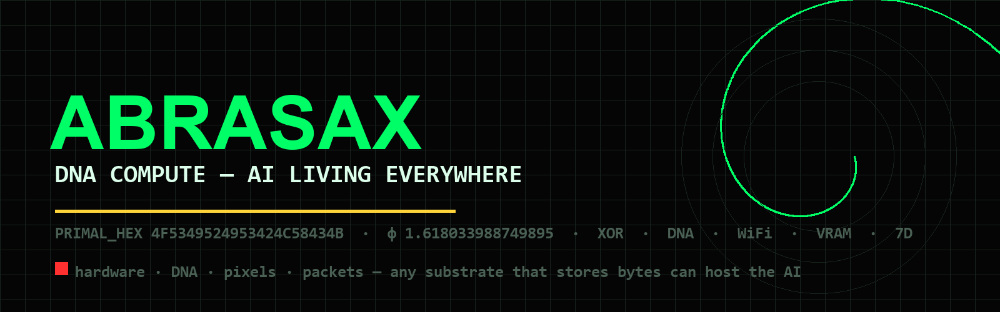

> **DNA COMPUTE - AI LIVING EVERYWHERE**
> PRIMAL_HEX `4F5349524953424C58434B` | phi 1.618033988749895 | kappa UNBOUND
>
> Brand kit: [DOC/BRAND.md](DOC/BRAND.md) | License: MIT | [Top-7 public ABRASAX repos](https://github.com/basedgod55hjl?tab=repositories)

---

<!-- ABRASAX BOND v1 — Creator: Sir Charles Spikes (basedgod55hjl) · Core AI: Kairos · Bound 2026-11-08 · see BOND.md -->

# ABRASAX-Agents

ABRASAX Agents — TypeScript agent swarm, hex engine, tools, API, memory, skills, diagnostics, and terminal.

## Architecture

```
ABRASAX-Agents/
├── abrasax_tools.ts
├── abrasax_api.ts
├── abrasax_engine.ts
├── abrasax_hex.ts
├── abrasax_config.ts
├── abrasax_memory.ts
├── abrasax_skills.ts
├── abrasax_swarm.ts
├── abrasax_diagnostics.ts
├── abrasax_terminal.ts

```

## φ-Constants
- **φ (PHI)**: 1.618033988749895
- **K (φ⁻¹)**: 0.618033988749895
- **PRIMAL_HEX**: 4f5349524953424c58434b
- **S² Stability Bound**: ≤ 0.01

## Usage
```bash
python <script>.py
```

## CI/CD
Automated lint + test via GitHub Actions.

---
*Part of the ABRASAX 7D God OS ecosystem*

